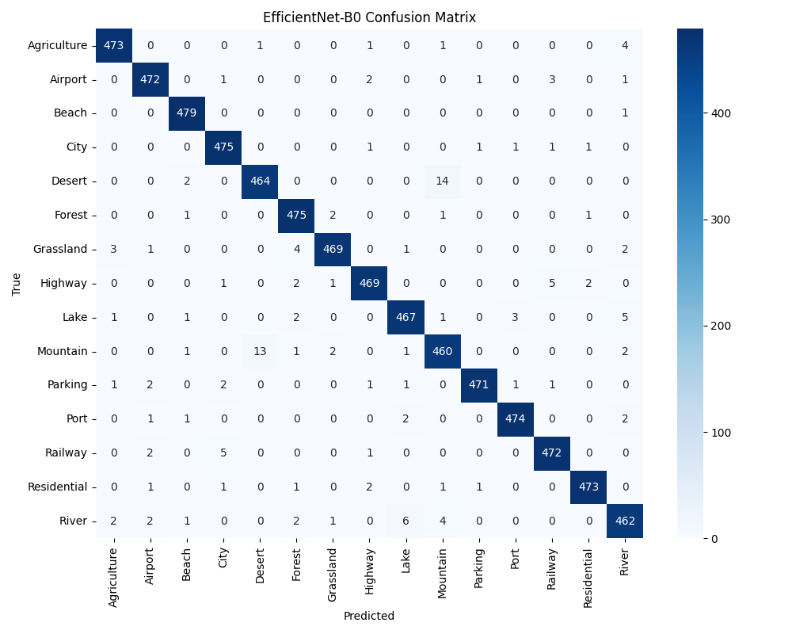
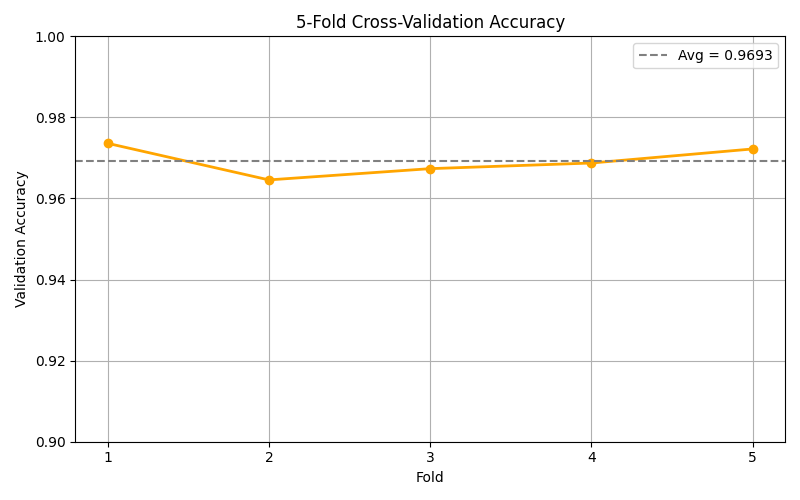

# Aerial Scene Classification with CNNs

Classifies aerial landscape images into **15 categories** (airport, beach, city, forest and so on) by fine-tuning two ImageNet-pretrained CNNs, ResNet-18 and EfficientNet-B0, and comparing them under 5-fold cross-validation.

## Results

5-fold cross-validation:

| Model | Accuracy | Precision | Recall | F1 |
|---|---|---|---|---|
| ResNet-18 | 96.93% | 96.95% | 96.94% | 96.92% |
| **EfficientNet-B0** | **97.99%** | **98.01%** | **97.99%** | **97.98%** |

- EfficientNet-B0 beat ResNet-18 on every fold with less than half the parameters (5.3M vs 11.7M).
- Both models reach above 96% with only 10 epochs per fold, helped by ImageNet pretraining and augmentation.

 

## Method

**Data.** 12,000 images, 800 per class, 256×256 ([Aerial Landscapes on Kaggle](https://www.kaggle.com/datasets/balraj98/aerial-landscapes), since taken down). `split_dataset.py` keeps 60% of each class for cross-validation.

**Models.**
- ResNet-18 and EfficientNet-B0, ImageNet-pretrained, fine-tuned end to end.
- 224×224 input, Adam (lr 1e-4), batch size 32, 10 epochs per fold.
- Augmentation: horizontal flip, ±15° rotation, colour jitter, random resized crop.

## Stack

Python 3.10, PyTorch, torchvision, scikit-learn, matplotlib, seaborn

## Run it

```bash
conda create -n torch310 python=3.10 -y && conda activate torch310
pip install torch torchvision scikit-learn numpy matplotlib seaborn tqdm

# put the dataset in ./Aerial_Landscapes/<class>/*.jpg, then from this folder:
python scripts/split_dataset.py          # creates dataset_split/train/
python scripts/train_ResNet18.py
python scripts/train_EfficientNet-B0.py
python scripts/test_ResNet18.py
python scripts/test_EfficientNet-B0.py
```

Training writes one model file and one classification report per fold into the current folder.

## Layout

```
scripts/   dataset split, training and testing for ResNet-18 and EfficientNet-B0
results/   confusion matrices and per-fold accuracy plots
```
