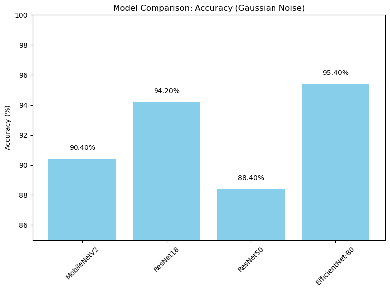
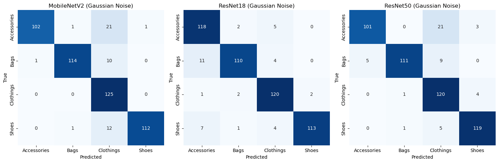

# Fashion Image Classification with CNNs

Classifies product photos into four categories (Accessories, Bags, Clothing, Shoes) with four ImageNet-pretrained CNNs, then tests how well each one holds up when Gaussian noise is added to the images.

**My role:** group project. I trained and evaluated all four models and ran the noise-robustness tests; a teammate prepared the balanced dataset.

## Results

Accuracy on 500 images (125 per class), from the run saved in [`notebook.ipynb`](notebook.ipynb). In the noisy run, Gaussian noise is added to a random half of the images.

| Model | Parameters | Clean images | Noisy run |
|---|---|---|---|
| MobileNetV2 | 3.5M | 99.6% | 89.0% |
| ResNet-18 | 11.7M | 98.8% | 92.2% |
| ResNet-50 | 25.6M | 100.0% | 88.2% |
| **EfficientNet-B0** | **5.3M** | **100.0%** | **92.4%** |

- On clean images every model is near-perfect, so clean accuracy does not separate them. Noise does.
- EfficientNet-B0 is the most robust with less than half the parameters of ResNet-18.
- ResNet-50, the largest model, drops the most under noise; with about 6,400 training images per fold, its extra capacity likely fits the clean training data rather than generalising.

 

**Limitations.** The 500 evaluation images are sampled at random from the full dataset, so some of them were also seen in training, and each new sample (and each random choice of which images get noise) gives slightly different numbers. The clean-image scores are therefore optimistic, and the noisy run is the more useful comparison. The noise is also added after normalisation and the result clipped to [0, 1], which distorts colours as well as adding noise. A fixed held-out test split and noise applied before normalisation would be the first things to change.

## Method

- **Data:** 8,000 images, 2,000 per class, built from the LAT and AAT image sets.
- **Models:** MobileNetV2, ResNet-18, ResNet-50 and EfficientNet-B0, ImageNet-pretrained, with the final layer replaced for 4 classes.
- **Training:** 5-fold cross-validation, 224×224 input, augmentation with random resized crop, horizontal flip, ±15° rotation and colour jitter, Adam (lr 1e-4, weight decay 1e-3), learning rate reduced on plateau, early stopping on validation loss. The best fold of each model is used for testing.
- **Robustness test:** the same models are scored on a run where a random half of the images get Gaussian noise (mean 0, σ 0.1); accuracy, confusion matrices and precision-recall curves are compared.

## Stack

Python, PyTorch, torchvision, efficientnet_pytorch, scikit-learn, matplotlib, seaborn

## Run it

```bash
pip install torch torchvision efficientnet_pytorch scikit-learn numpy pandas matplotlib seaborn pillow

# put the dataset in ./ATT_augmented/<class>/ and run from this folder
python scripts/train_mobilenet_5fold.py
python scripts/train_resnet18.py
python scripts/train_resnet50.py
python scripts/train_efficientnet_b0_5fold.py

python scripts/test_all_models.py           # accuracy on clean images
python scripts/compare_models.py            # noisy run; saves docs/results.pkl
python scripts/generate_comparison_plots.py # comparison plots from docs/results.pkl
```

Trained weights are saved to `models/`. Set `FASHION_DATA_DIR` if the dataset is somewhere else.

## Layout

```
scripts/          training (5-fold) and testing scripts for each model, plus comparison plots
results/          confusion matrices, accuracy and precision-recall plots, clean and noisy
notebook.ipynb    full walkthrough with outputs
```
